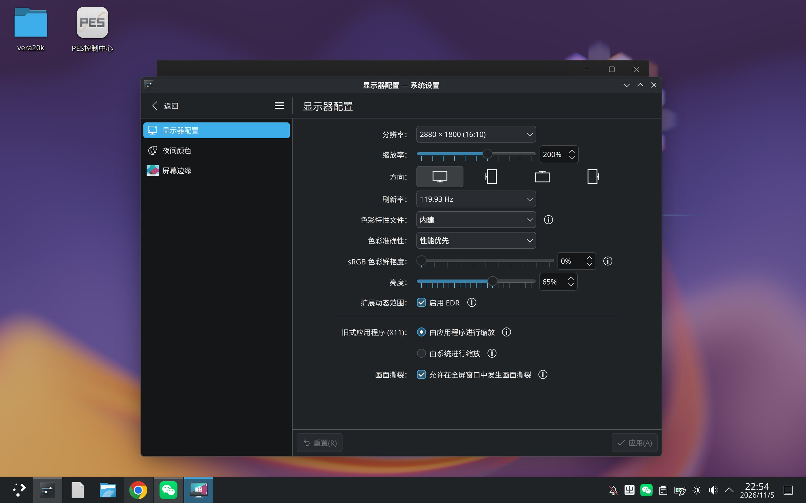
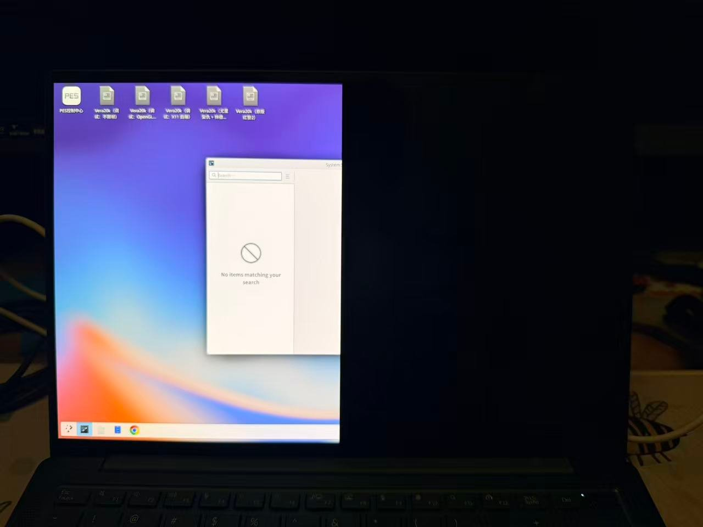

# 配置指南（安装后必读）

本文件是 `mtgpu-kde` 的落地配置清单。按顺序做，全部做完再进桌面。

- 目标环境：AIOS / Ubuntu 24.04 ARM64 + 摩尔线程 M1000 + 14" AM-OLED（2880×1800@120Hz, 10-bit）
- KDE 版本：**Plasma 6.8.2**（Qt 6.11.3 / KF6 6.31），隔离前缀 `/opt/kde6`



---

## 1. 安装

见 [README.md](README.md) 的安装章节。deb 包发布在 GitHub Releases：

<https://github.com/yeungtuzi/mtgpu-kde/releases>

```sh
sudo dpkg -i kde6-mtgpu-*.deb
```

装完不要立刻切换会话，先做完第 2、3 节，否则会以错误的输入法与半屏状态进入桌面。

---

## 2. 输入法：必须用 fcitx5（rime 方案已确认不行）

### 为什么换掉 ibus-rime

早期版本跟随系统默认的 **IBus 1.6.0 + ibus-rime**。在 KDE 会话里这条路很别扭：

- GNOME 会话本身已经有一个 `ibus-daemon --panel disable` 在跑（同一用户）；
- KDE 会话再起一个 `ibus-daemon` 会争用 `~/.config/ibus/bus` 的地址文件，表现为
  **输入法时好时坏、切不出中文、或直接把整个 IBus 弄挂**；
- 绕过办法是给 KDE 会话一个独立的 `IBUS_ADDRESS`（见下），但 `ibus-daemon --address`
  的行为在不同版本间不一致，属于"能跑但一直要伺候"的状态。

**结论（已确认）：KDE 会话必须用 fcitx5，rime 这条路走不通。**
这不是「配置得好不好」的问题——IBus/Rime 与 KDE 会话争用同一份
`~/.config/ibus/bus` 地址文件，是结构性的，调参只能让它多撑一会儿。
直接换 fcitx5。 fcitx5 有自己的 D-Bus 命名空间，
与 GNOME 的 IBus 完全隔离，两个会话可以共存，不需要任何 `IBUS_ADDRESS` 技巧。

### 安装

```sh
sudo apt install fcitx5 \
                 fcitx5-chinese-addons \
                 fcitx5-frontend-qt6 \
                 fcitx5-frontend-gtk3 \
                 fcitx5-frontend-gtk4
```

`fcitx5-chinese-addons` 带拼音；如果想要 Rime 的引擎，装 `fcitx5-rime` 即可
（注意：是 **fcitx5-rime**，不是 ibus-rime）。

### 设为默认

```sh
im-config -n fcitx5
```

### 环境变量

写入 `/opt/kde6/session.env`（会话启动脚本会 source 它）：

```sh
export LANG=zh_CN.UTF-8
export LANGUAGE=zh_CN:en

export GTK_IM_MODULE=fcitx
export QT_IM_MODULE=fcitx
export XMODIFIERS=@im=fcitx
export SDL_IM_MODULE=fcitx
```

> 如果之前按旧文档写过 `GTK_IM_MODULE=ibus` / `QT_IM_MODULE=ibus` / `XMODIFIERS=@im=ibus`，
> **必须全部改成 fcitx**，否则 Qt/GTK 会去找不存在的 IBus daemon，输入法直接失效。

### 自启

```sh
mkdir -p ~/.config/autostart
cp /usr/share/applications/org.fcitx.Fcitx5.desktop ~/.config/autostart/
```

### 验证

```sh
fcitx5-remote -o        # 打开输入法，应回显 2
fcitx5-diagnose | head -40
```

在 Konsole / KWrite 里按 `Ctrl+Space` 应能切出拼音候选框。

---

## 3. 半屏 / 黑屏问题（KWin + mtgpu）

### 现象



- 物理面板只显示**左半边**桌面，右半边黑；光标有时可见、有时撕裂；
- 换 2560×1600、1920×1200、60Hz 都一样；
- 缩放 100% / 160% 都一样；关掉 EDR、清空 ICC 也一样。

**关键证据**：用 kmsgrab 直接抓 KMS primary plane，拿到的是**完整的 2880×1800 桌面**。

```sh
sudo ffmpeg -hide_banner -f kmsgrab -i - \
  -vf "hwdownload,format=rgb0" -frames:v 1 /tmp/scan-rgb0.png
```

也就是说 KWin 画得是完整的、送进 KMS 的 framebuffer 也是完整的，
**问题出在 KMS → mtdisp → 面板这一段**，不是 KWin 少画了一半。
同机器同模式下 GNOME（mutter）显示完整，说明是 KWin 与 mtgpu 的组合问题。

### 根因

KWin 在每次 atomic commit 时会给 primary plane 设置 `FB_DAMAGE_CLIPS`，值为 `0`
（语义是"整帧"）：

```cpp
// kwin/src/backends/drm/drm_pipeline.cpp
if (plane->fbDamage.isValid()) {
    commit->addProperty(plane->fbDamage, 0);
}
```

mtdisp 把 `0` 错误地解释成了**半宽**，于是只扫描左半边。

- 保留该属性（0）→ 左半屏
- 完全移除该属性 → 全屏黑（连左半都没有，说明该属性是 mtgpu 更新 plane 的必要条件）
- **给它一个覆盖整帧的真实 blob** → 正常

### 规避

仓库自带 `tools/set-full-damage`，在 KWin 运行时把 `FB_DAMAGE_CLIPS` 持续设成
`drm_mode_rect{0,0,w,h}`：

```sh
gcc -O2 -o set-full-damage tools/set-full-damage.c $(pkg-config --cflags --libs libdrm)
sudo ./set-full-damage      # Ctrl-C 停止
```

设置后若画面恢复完整，即确认是 `0` 值的语义问题。长期方案是在 KWin 的
`DrmPipeline` 里改用同样的 full-rect blob（而不是 0）。

### 如果还是黑屏

按顺序试：

1. 确认走的是 `/opt/kde6` 的 KWin，不是系统 `/usr/bin/kwin_wayland`：
   `readlink -f $(which kwin_wayland)`
2. `journalctl -b -u gdm -n 100` 与 `~/.local/share/kwin/*.log` 找 plane/format 报错
3. 临时关闭 direct scanout：`KWIN_DRM_NO_DIRECT_SCANOUT=1`（只影响性能，不影响正确性）
4. 换 60Hz 先确认链路通，再回到 120Hz

### 回退到 GNOME

整个过程不改 GNOME。回退只需：

```sh
sudo sed -i 's/^Session=.*/Session=ubuntu/' /var/lib/AccountsService/users/$USER
sudo systemctl restart gdm
```

---

## 4. 显示与色彩（EDR）

工作状态参考图（见文首）使用的设置：

| 项 | 值 |
|---|---|
| 分辨率 | 2880×1800 (16:10) |
| 缩放 | 200% |
| 刷新率 | 119.93 Hz |
| 色彩特性文件 | 内建 |
| 色彩准确性 | 性能优先 |
| 扩展动态范围 | 启用 EDR |
| 旧式应用程序(X11) | 由应用程序进行缩放 |

KWin 6.8 内置 EDR，**不需要**给 KWin 打补丁。它会在「有 brightnessDevice + 内屏 +
不支持标准 HDR」时自动置 `Capability::Edr`，并按 HDR 内容的 `maxHdrLuminance`
动态提升 headroom（上限 3×）。

前置条件：powerdevil 能提供 brightness device。若 System Settings 里看不到
"启用 EDR"，检查 powerdevil 的 D-Bus system service 是否已注册到
`/usr/share/dbus-1/system-services`。

硬件 HDR 元数据路径目前被驱动卡住（connector 没有 `HDR_OUTPUT_METADATA` /
`Colorspace`），详见 [notes/hdr-driver-findings.md](notes/hdr-driver-findings.md)。

---

## 5. 已知限制

- 半屏问题是 **KWin × mtgpu** 的组合 bug，`set-full-damage` 是运行时规避；
  根治要么改 KWin（换成 full-rect blob），要么等驱动侧修 `FB_DAMAGE_CLIPS` 的 0 值语义。
- 硬件 HDR 不可用，只有 EDR。
- 全部构建在 `/opt/kde6`，不覆盖系统 `/usr`；但**会话级**配置（`im-config`、
  `~/.config/autostart`）是全局的，切回 GNOME 后 fcitx5 仍会生效。
