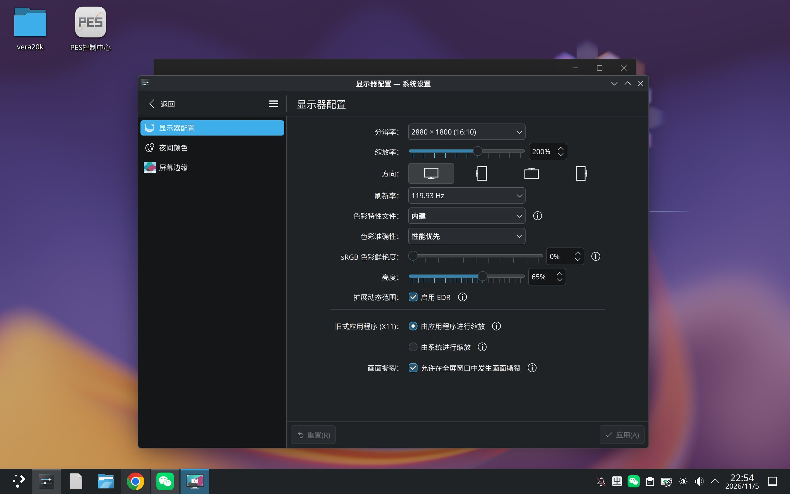
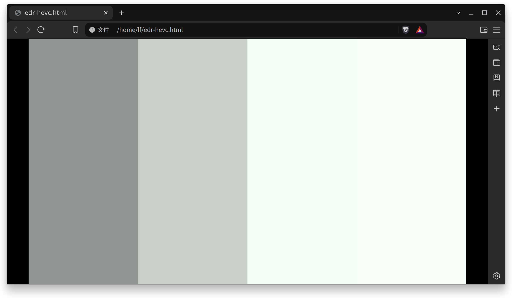
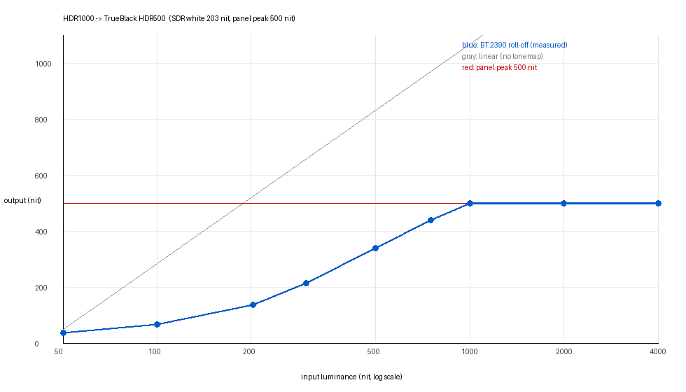

# kde6-mtgpu

> ## ⚠️ 警告：试验性支持，尚未进行长期稳定性验证
>
> 本项目的 KDE Plasma 6.8 构建与 EDR **均处于试验阶段**。
> 没有做过长时间连续运行、反复会话切换、休眠唤醒、多显示器插拔等稳定性验证。
> **不要用于生产环境，也不要作为唯一可用的桌面环境。**
> 使用前请确认已掌握 [CONFIG.md](CONFIG.md) 里的回退方法（随时可退回 GNOME）。

---

**KDE Plasma 6.8 在 AIOS（Ubuntu 24.04 / ARM64 / 摩尔线程 M1000）上的移植与色彩管理/EDR 验证。**

目标（按优先级）：

1. **硬性**：全局色彩管理——每个输出能加载各自的 ICC，colord 中有对应 profile，KWin 实际把 LUT/ICC 应用到输出。
2. **硬性**：可用的 Wayland 桌面，在 tty3 独立测试，不改变 GNOME 默认会话，随时可回退。
3. **探索**：HDR 在驱动层被卡死（connector 没有 `HDR_OUTPUT_METADATA`/`Colorspace`）；
   因此改为验证 **Apple 式 EDR**（不需要 HDR 元数据，只要求面板峰值 > SDR 白）。

## 配置指南

**装完先看 [CONFIG.md](CONFIG.md)**：输入法（用 fcitx5，不要用 ibus-rime）、
显示与 EDR 设置、回退方法都在里面。




> **打包事故说明（2026-11-13）**：`v6.8.2-mtgpu4` 的 deb 残留了构建树前缀 `/opt/kwin-patched`
> （含 `plasma-kwin_wayland.service`），会让接入 `/opt/kde6` 的机器 KWin 启动失败（`203/EXEC`）。
> 该版本资产已撤回，`v6.8.2-mtgpu7` 已修正并在打包脚本里加了路径改写与校验。
> 若你的 `/etc/xdg/systemd/user/plasma-kwin_wayland.service` 指向 `/opt/kwin-patched`，
> 请改为 `/opt/kde6/bin/kwin_wayland_wrapper`。


> **重要更正（2026-11-13）**：`v6.8.2-mtgpu4`/`mtgpu5` 的 deb **都没有包含 `libkwin.so.6.8.2`**
> （打包脚本的 multiarch 路径 bug），因此 **EDR 补丁此前从未随 overlay 真正交付**；两份资产均已撤回。
> `v6.8.2-mtgpu7` 已修复并在 chroot 与实机双重验证：1725 个文件齐全、md5 与 deb 一致、依赖 0 缺失。

## 系统级 EDR：不需要再自己编译浏览器（2026-11-13）

**结论先行**：EDR 现在是**合成器（KWin）侧的能力**，`mtgpu-kde` 装好即可，
**预装 Google Chrome、Brave 等 Chromium 系浏览器无需改一行代码就能获得 EDR**。

* 新增补丁 [`patches/kwin-6.8.2-edr-advertise-1000.patch`](patches/kwin-6.8.2-edr-advertise-1000.patch)：
  在 `wp_image_description_info_v1_send_luminances()` 里把通告给客户端的 **HDR 最大值下限抬到 1000 nit**
  （物理面板峰值仍是 500 nit），同时 `target_luminance` 也固定为 1000。
* 之前缺的正是这一步：客户端按 `luminances.max`（旧值 500）判断显示能力，不会再请求头空间；
  抬到 1000 后，客户端按 HDR 输出，合成器再用 BT.2390 LUT 压回 500 nit 面板，
  于是 **HDR1000 内容不再是"裁到 500"，而是滚降映射，观感接近 TrueBlack HDR500**。
* SDR 参考白仍随亮度滑条变化，未受影响。




*Brave 1.99.57 播放 `hdr-bars.mp4`：四段亮度条在面板上可分辨；截屏经 SDR 抓取会把 SDR 白以上的高光压到一起，
所以第 3、4 段在图上接近纯白，实际观感中 1000 nit 段更亮。*



*实测映射：100→65.5、203→135.4、500→338.5、1000→500 nit（面板峰值），高于 1000 nit 的部分由 EETF 压平。*

实测（同一台 AIBOOK，`hdr-bars.mp4` 四段 100/203/500/1000 nit）：

| 浏览器 | VPU 硬解 | EDR |
|---|---|---|
| 预装 **Google Chrome** | ✅ 默认 | ✅ |
| **Brave 1.99.57**（Chromium 157） | ✅ 默认（Decoder 2.8–6.0%） | ✅ |
| 自编 mtgpu-chromium | ✅ | ✅ |

判定证据（KWin 日志）：`EDRK shader tonemap=1 maxWhite=1003.2 maxOut=500.0 tf=2`，
探针读数 `LUMINANCES max=1000`、`TARGET_LUM max=1000`。

因此：**只想在 AIBOOK 上看 HDR/EDR，装 `mtgpu-kwin-edr` 就够了，不必自己编译浏览器**；
自编浏览器的意义只剩"去 Google / 完全可控"。

## 关键结论（2026-11-09 修正）

* 本项目只做 **Plasma 6.8.2**，全部从源码构建；当前版本 **6.8.2-mtgpu7**。
* KWin 6.8 **内置 EDR 支持**，不需要补丁去"打开 EDR"：
  * `drm_output.cpp` 在「有 brightnessDevice + 内屏 + 不支持标准 HDR」时直接置 `Capability::Edr`；
  * `compositor.cpp` 会按屏幕上 HDR 内容的 `maxHdrLuminance/referenceLuminance` 动态提升"人工 HDR headroom"（上限 3×，按亮度余量封顶）；
  * 每个输出有 `edrPolicy`（Always/Never），默认 Always。
  * 见 `notes/edr-findings-6.8.md`。
* 但 EDR 分支的**峰值亮度是硬编码 200 nit**：`maxPeakBrightnessOverride` 只在 HDR 分支生效，
  于是合成器对客户端通告 `max=200`，HDR 高光全被裁到 SDR 白，观感上"没有 HDR"。
  * 诊断与实测见 `notes/edr-peak-luminance-6.8.md`；
  * 修复补丁 `patches/kwin-6.8.2-edr-peak-luminance.patch`（用 `tools/apply-kwin-edr.sh` 应用）；
  * 补丁同时把亮度滑条改成**软件白点**、硬件背光恒定满，符合 OLED EDR 的用法。
* 补丁后 eDP-1 通告 `max=1000`（mtgpu4 起）、`reference` 随滑条变化，
  Chrome/Brave 按 1000 nit 输出，KWin 用 BT.2390 滚降到 500 nit 面板。
* 客户端现状：Chrome 157 可用（ANGLE + MTT Mesa GLES）；mpv 0.42 协议层可用，
  但本机 MT 驱动的 Vulkan Wayland WSI 报 `VK_ERROR_UNKNOWN`，且其 EGL 初始化选不到 MTT GL，
  暂时无法出画——详见 `notes/edr-peak-luminance-6.8.md` 第 5 节。


## 原生 HDR 探索结论（2026-11-13，已结案）

**结论：不做。** 面板不具备值得投入的原生 HDR 能力，现有 EDR 已是合适方案。

证据：
- 面板 EDID：制造商 **EDO**、型号 **5160**、产品串 `EE00QBA62.A`，同系列 BA63.E / BA64.A 公开标称 **400–500 nit**；
  EDID 峰值 507.6 nit，厂商"1000 nit"仅可能是小窗口激发，日常大面积显示达不到。
- 驱动：`mtgpu.ko 5.3.1-M1000` **没有标准 connector 属性** `HDR_OUTPUT_METADATA` / `max bpc`，
  KWin 因此判定 `HDR: incapable`；只有私有 plane 属性 `HDR(0/1)`、`EOTF(blob)`、`GAMUT_MAP(blob)`，且无任何文档或源码。
- 实测：独立 libdrm 工具（KWin 停止时）可正常 modeset，但无法确认 EOTF blob 语义；面板进入 HDR 模式的证据不足。
- 收益评估：面板峰值 ~500 nit，HDR1000 内容无论如何要滚降，与现有 BT.2390 → TrueBlack HDR500 的观感差异极小；
  强行驱动超出标称亮度还会加速 OLED 老化。

结论：保留 EDR 方案，不再尝试 vendor HDR 通路。


## 常见问题：重启后亮度变 100% / plasmashell 不启动

这是两个独立问题，mtgpu7 起都已处理：

### 1. 亮度被重置为 100%

EDR 模式下硬件背光被钉在最大，KWin 曾把"观测到的硬件亮度"当成用户设置，导致每次登录都回到 100%。
修复补丁：[`patches/kwin-6.8.2-edr-brightness-restore.patch`](patches/kwin-6.8.2-edr-brightness-restore.patch)
（EDR 激活时改用 `kwinoutputconfig.json` 中的 brightness）。验证：重启两次后仍恢复 40%。

### 2. 登录后没有面板 / plasmashell 反复崩溃

若 `journalctl --user -u plasma-plasmashell` 出现
`Could not load the Qt platform plugin "wayland"`，说明 systemd 用户单元没拿到 Qt/Wayland 环境。
在机器上补两处（一次性）：

```bash
mkdir -p ~/.config/environment.d ~/.config/systemd/user/plasma-plasmashell.service.d
cat > ~/.config/environment.d/15-mtgpu-kde.conf <<EOF
LD_LIBRARY_PATH=/opt/kde6/lib:/opt/kde6/lib/aarch64-linux-gnu
QT_PLUGIN_PATH=/opt/kde6/plugins:/opt/kde6/lib/plugins
XDG_DATA_DIRS=/opt/kde6/share:/usr/local/share:/usr/share
EOF
cat > ~/.config/systemd/user/plasma-plasmashell.service.d/override.conf <<EOF
[Unit]
StartLimitIntervalSec=0
After=plasma-kwin_wayland.service
Wants=plasma-kwin_wayland.service

[Service]
Restart=on-failure
RestartSec=3
Environment=QT_PLUGIN_PATH=/opt/kde6/plugins:/opt/kde6/lib/plugins
Environment=LD_LIBRARY_PATH=/opt/kde6/lib:/opt/kde6/lib/aarch64-linux-gnu
Environment=XDG_DATA_DIRS=/opt/kde6/share:/usr/local/share:/usr/share
Environment=QT_QPA_PLATFORM=wayland
Environment=WAYLAND_DISPLAY=wayland-1
EOF
systemctl --user daemon-reload
```


### 3. 黑屏只有光标（重启会话后）

**不要**直接 `systemctl restart gdm`：旧 KWin 还占着 DRM master 时新实例会拿不到输出，
表现为 KWin 在跑、plasmashell 在跑，但 `kscreen-doctor` 显示 **0 个输出**、屏幕只有光标。

正确重启顺序：

```bash
systemctl --user stop plasma-kwin_wayland.service plasma-plasmashell.service
sleep 5
sudo systemctl restart gdm
```

验证是否真的好了：`kscreen-doctor -j | jq '.outputs | length'` 必须 ≥ 1，而不是只看进程数。

## 构建策略

* **全部源码构建**：Qt 6.11.3 → KDE Frameworks 6.31 → Plasma 6.8.2。
* **隔离前缀 `/opt/kde6`**：不覆盖系统 `/usr` 里的任何文件；KDE 只通过运行时环境变量接入。
* 编译器：**GCC 15.2**（系统已有 `/usr/bin/gcc-15`），`-O2 -march=native -mtune=native -pipe`，ccache 加速。
* 构建工具从源码补齐：CMake 3.31.12（ECM 6.31 要求 ≥3.30）。
* 系统 apt 只安装"构建期依赖"（dev 头文件等），**不升级/降级厂商（MTT）运行时二进制**；
  对 MTT 源里优先级 1001 的 polkit/libinput/pipewire 已做 pin/hold，避免改动。
* **本地补丁在编译前自动应用**：`tools/build-core-final.sh` 会在配置 kwin 之前调用
  `tools/apply-kwin-edr.sh`（幂等）；手工构建时也要先跑一次，否则二进制与发布的不一致。
  构建脚本：[tools/build-one.sh](tools/build-one.sh)（单组件）、
  [tools/build-core-final.sh](tools/build-core-final.sh)（kwin 及 Plasma 核心）。

## 文档

* [notes/build-6.8.md](notes/build-6.8.md) —— 从源码构建的完整步骤、路径、日志
* [notes/edr-findings-6.8.md](notes/edr-findings-6.8.md) —— KWin 6.8 的 EDR 实现与验证方法
* [notes/edr-peak-luminance-6.8.md](notes/edr-peak-luminance-6.8.md) —— 峰值亮度硬编码 200 的诊断、补丁与实测（2026-11-09）
* [patches/kwin-6.8.2-edr-peak-luminance.patch](patches/kwin-6.8.2-edr-peak-luminance.patch) + [tools/apply-kwin-edr.sh](tools/apply-kwin-edr.sh) —— EDR 峰值亮度补丁
* [tools/edr-probe](tools/edr-probe) —— 读取 `wp_color_management_v1` 通告的 max/reference 的小工具
* [tools/edr-pattern](tools/edr-pattern) —— 不依赖 GL/Vulkan 的 wl_shm EDR 测试画面
* [tools/build-core-final.sh](tools/build-core-final.sh) / [tools/build-one.sh](tools/build-one.sh) —— 可复现的 KDE 核心构建（含自动打补丁）
* [notes/edr-brightness-semantics.md](notes/edr-brightness-semantics.md) —— 物理亮度 / SDR 白 / headroom 的映射设计
* [notes/hdr-driver-findings.md](notes/hdr-driver-findings.md) —— 驱动能力实测（P0，仍有效）
* [CONFIG.md](CONFIG.md) —— 安装后配置清单（fcitx5 / EDR / 回退）
* [notes/packaging-deb.md](notes/packaging-deb.md) —— 把 /opt/kde6 打成 .deb + meta 包的方案
* [notes/lowload-baseline.md](notes/lowload-baseline.md) —— 机器低负载基线
* [notes/network-tray-6.8.md](notes/network-tray-6.8.md) —— 补编 plasma-nm / qtkeychain / ModemManagerQt，修复 Wi-Fi 设置与系统托盘缺失

当前状态（2026-11-05 20:30）：

* **构建**：Qt 6.11.3、KF6 6.31、Plasma 6.8.2 核心已全部构建并安装到 `/opt/kde6`；
  GDM 可自动登录 `Plasma 6.8 (kde6-mtgpu)` 会话，`plasmashell`/`kwin_wayland`/`powerdevil` 均可启动。
* **ICC**：`kscreenctl eDP-1 set-icc-profile ...` 成功，`kwinoutputconfig.json` 中
  `iccProfilePath` 已持久化；`kscreenctl list-outputs` 显示 ICC profile 已挂到 eDP-1。
* **EDR**：KWin 6.8 的 `Allow EDR: always` 已出现（需要 powerdevil 提供 brightness device；
  已把 powerdevil 的 D-Bus system service 注册到 `/usr/share/dbus-1/system-services`）。
  2026-11-09 完成实测：打上峰值亮度补丁后，eDP-1 通告 `max=500 nit`、`reference` 随滑条变化，
  Chrome 播放 PQ 测试图可见 500 nit 高光明显亮于 SDR 白。
* **扫描输出**：正常，整屏完整显示（2880×1800 @120Hz）。
* **回退**：把 `/var/lib/AccountsService/users/lf` 的 `Session=` 改回 `ubuntu` 并
  `sudo systemctl restart gdm` 即回 GNOME；GNOME 本身未改动。
